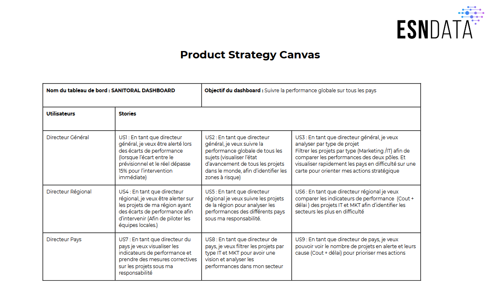
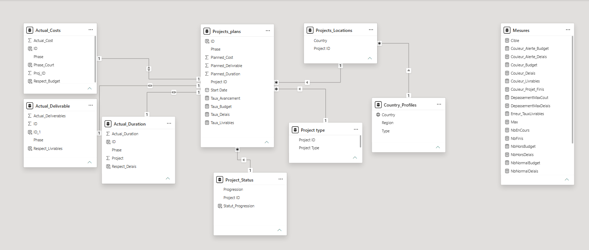
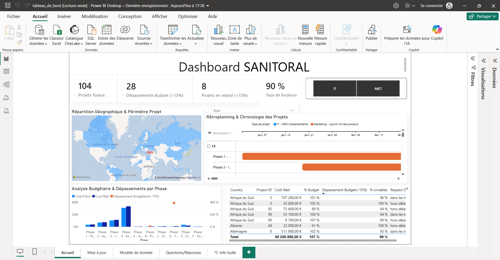

# 📊 Créer un tableau de bord dynamique avec Power BI

*Projet 7 de la formation **Business Intelligence Analyst** – OpenClassrooms · Projet validé*

## 🎯 Contexte et objectif

**ESN Data** devait suivre l'avancement de ses projets (Marketing et IT) dans tous les pays où elle intervient.

Ma mission : **concevoir un tableau de bord Power BI** qui permette aux directeurs (général, régional et pays) de **suivre les coûts, les délais et les livrables**, et d'être **alertés quand un projet dérape** (écart de plus de 15 % entre le prévu et le réel).

## 🛠️ Outils et compétences

- **Recueil du besoin** : *Product Strategy Canvas* et **user stories** pour chaque type d'utilisateur
- **Power BI** : Power Query, **modèle de données** (relations entre les tables), **mesures DAX** (taux de respect du budget et des délais, nombre de projets hors budget ou hors délais…)
- **Visualisation** : carte géographique, rétroplanning (diagramme de Gantt), mise en forme conditionnelle des alertes, info-bulles personnalisées, filtres par région, pays et type de projet
- **Documentation** : procédure de mise à jour du rapport

## 🔎 Démarche

1. **Recueillir les besoins** des utilisateurs sous forme de user stories
2. **Préparer les données** et construire le **modèle de données**
3. **Créer les mesures** et les indicateurs de risque
4. **Concevoir le rapport** : vue géographique, analyse budgétaire par phase, détail des dérives, rétroplanning
5. **Documenter** la mise à jour pour que le rapport reste utilisable

## 📊 Aperçu

**Recueil du besoin : Product Strategy Canvas et user stories**

**Modèle de données**

<!-- Ajoute ici une capture de la page d accueil du tableau de bord :
 -->

## 📁 Fichiers du projet

| Fichier | Contenu |
|---|---|
| [tableau_de_bord.pbix](tableau_de_bord.pbix) | Le rapport Power BI (à télécharger et ouvrir avec Power BI Desktop, gratuit) |

---
👩‍💼 **Manal Salhi** – Business Analyst / Data Analyst · [LinkedIn](https://www.linkedin.com/in/manal-salhi-030a692b5/)
